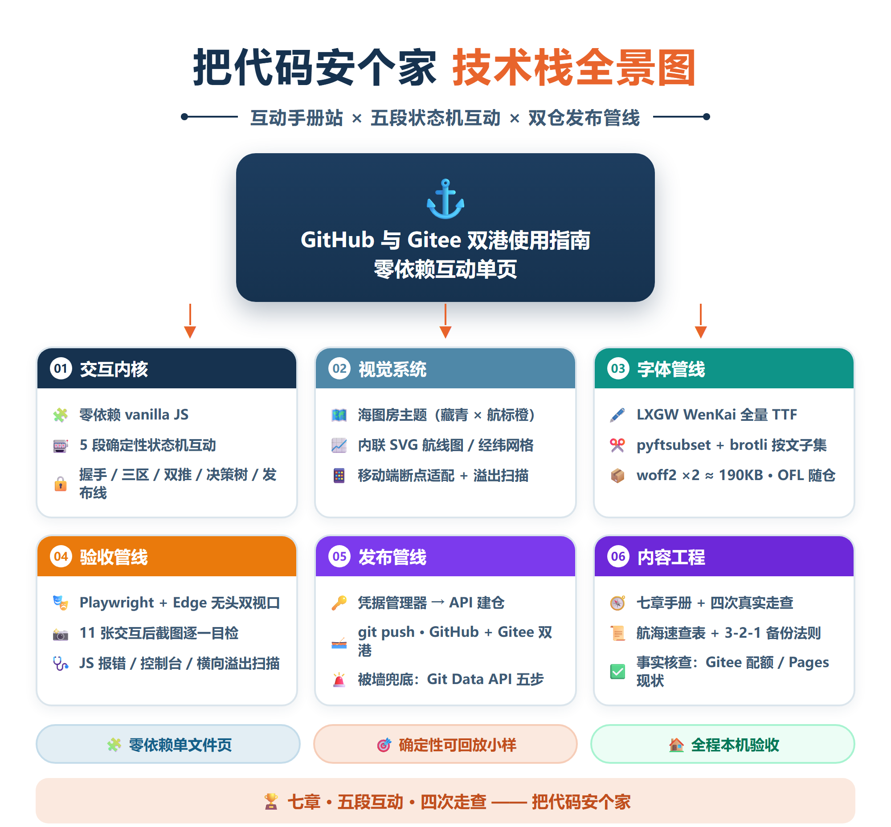

# 把代码安个家 · 托管手册（GitHub 与 Gitee）

> 代码托管科普互动手册：注册、认证、第一次 push，到双仓互备、断网自救、Pages 发布——七章全部拆开给你玩，五段互动全是确定性状态机。

**在线阅读：<https://starrysea1412.github.io/git-primer/>**

## 七章

1. **两座仓库** —— GitHub 与 Gitee 的分工：配额表、2FA、实名与审核
2. **认证** —— 密码之死（2021-08）、classic vs fine-grained 令牌、SSH 挑战-应答、443 备用端口 · 互动「认证握手台」
3. **提交** —— blob/tree/commit 对象模型、三区流水线、.gitignore 只防新文件的完整论证 · 互动「三区流水线」
4. **双仓** —— Gitee 导入 vs 双 pushurl、多地址串行执行的真相、分叉纪律 · 互动「双仓调度台」（可模拟断网）
5. **断网** —— curl 隔离变量、socks5h、镜像保质期、Git Data API 五步空投 · 互动「排障决策树」
6. **发布** —— Pages 三种源、.nojekyll、软限额度、gh-pages 半成品坑 · 互动「发布流水线」
7. **协作** —— Issue 三段论、fork≠clone、分支保护、五人边界

附录：速查卡「如果只带走十句」。四次真实走查：Gitee 换 SSH、双仓 `.git/config` 原文、Git Data API 两个坑、gh-pages 半成品 404。

## 技术

零依赖单页 `index.html` + `demo.js`（≈70KB）· 5 段确定性状态机互动 · 霞鹜文楷按文子集（pyftsubset，OFL 随仓）· Playwright + Edge 无头双视口验收（`build/verify.mjs`）· GitHub Pages 发布

文中政策类数据（Gitee 免费配额、开源人工审核、Gitee Pages 下线）核对于 2026-11。

---

StarrySea1412 / 2026 · 托管手册 · 与《你按下回车之后》《咔嚓！光是怎么变成照片的》同架
